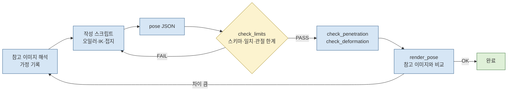

# poses — 포즈 데이터 형식

포즈 파일 하나는 정지 포즈 하나다. 같은 파일이 `rig/female.glb`와 `rig/male.glb`에 그대로 적용된다. 두 모델이 같은 스켈레톤 규칙 `pose-library-humanoid-v1`(뼈 이름, 계층, rest 축은 `rig/README.md`)을 쓰고, 회전이 각 뼈의 rest 프레임 기준이며, 루트 이동이 골반 높이 비율로 저장되기 때문이다. 스키마는 `schema.json`(JSON Schema 2020-12)이다.

| 파일 | 내용 |
|---|---|
| `schema.json` | 포즈 JSON 스키마 |
| `pose_01_contrapposto_hand_on_head.json` | 첫 포즈(콘트라포스토, 한 손은 허리, 한 손은 머리 위) |
| `reference/pose_reference_01.png` | 첫 포즈의 참고 이미지 사본(원본 `/tmp/pose-ref/pose_reference_01.png`, 출처·라이선스 미상) |

## 1. 구조

```json
{
  "$schema": "./schema.json",
  "formatVersion": 1,
  "skeleton": "pose-library-humanoid-v1",
  "meta": {
    "id": "pose_01_contrapposto_hand_on_head",
    "name": "Contrapposto, hand on head",
    "description": "…",
    "sourceImage": { "path": "poses/reference/pose_reference_01.png", "originalPath": "…", "sha256": "…" },
    "targetModels": ["female", "male"],
    "assumptions": ["…"],
    "generator": "rig/tools/author_pose_01.py"
  },
  "root": { "translation": [-0.040385, -0.0085, 0.0], "unit": "hipsHeight" },
  "bones": {
    "pelvis":     { "quaternion": [0.0142, 0.0533, -0.0600, 0.9966], "euler": { "order": "XYZ", "degrees": [2.0, 6.0, -7.0] } },
    "upperarm_l": { "quaternion": [ … ], "euler": { "order": "XYZ", "degrees": [ … ] } }
  }
}
```

| 필드 | 필수 | 의미 |
|---|---|---|
| `formatVersion` | 예 | `1` |
| `skeleton` | 예 | `"pose-library-humanoid-v1"` |
| `meta.id` | 예 | `[a-z0-9_]+`, 파일 이름(확장자 제외)과 같음 |
| `meta.name`, `meta.description` | 예 | 사람이 읽는 이름·설명. 좌우는 캐릭터 자신 기준 |
| `meta.sourceImage` | 아니오 | 참고 이미지: 저장소 상대 경로 `path`, 원래 경로 `originalPath`, `sha256` |
| `meta.targetModels` | 예 | 작성·검사한 모델(`female`, `male`). 첫 항목이 접촉·접지를 맞춘 모델 |
| `meta.assumptions` | 아니오 | 해석상의 가정(한 장 이미지의 깊이 등) |
| `meta.generator` | 아니오 | 파일을 만든 스크립트 |
| `root.translation` | 예 | `pelvis`의 rest 위치에서의 이동. 모델 공간(+Y 위, +Z 앞, +X 캐릭터 왼쪽) |
| `root.unit` | 예 | `"hipsHeight"`: `translation`에 대상 모델의 rest 골반 높이(female 0.8666 m, male 0.9369 m)를 곱해 미터로 쓴다 |
| `bones.<name>.quaternion` | 예 | **기준값.** 단위 쿼터니언 `[x, y, z, w]`. 뼈의 rest 로컬 프레임 기준 회전 |
| `bones.<name>.euler` | 아니오 | **참고값.** 같은 회전의 three.js Euler(`order: "XYZ"`, R = Rx·Ry·Rz, 도). 쿼터니언과 0.05° 이내로 일치해야 함 |

`bones`에 없는 뼈는 rest 상태다. 뼈 이름은 스키마의 enum(53개)만 허용한다.

## 2. 적용 공식

포즈를 적용할 때 각 뼈의 로컬 회전은 rest 로컬 회전 뒤에 포즈 회전을 곱한 값이다. 이동은 루트(`pelvis`)에만 있다.

```
local rotation(bone) = restLocalRotation(bone) × pose.bones[bone].quaternion
pelvis.position      = restPosition(pelvis) + root.translation × restPosition(pelvis).y
```

```
포즈 JSON 읽기 → 뼈별 rest × quaternion → pelvis 위치 += translation × 골반 높이 → 스키닝
```

three.js 코드 예시와 축 의미(+X 굴곡 등, 좌우 미러 규칙)는 `rig/README.md` 3–4절에 있다. 좌우 미러 포즈를 만들려면 `_l`↔`_r`을 바꾸고 오일러 Y·Z 부호를 뒤집는다(쿼터니언으로는 x 유지, y·z 부호 반전). 중심 뼈와 루트는 Y·Z를 뒤집고 이동 x 부호를 바꾼다.

## 3. 작성과 검사

쿼터니언이 기준이지만, 사람이 편집하기 쉬운 것은 오일러다. 작성 스크립트는 오일러로 정하거나 계산한 값에서 쿼터니언을 만들고 두 값을 함께 쓴다. 검사 단계는 다음과 같다.



명령은 `rig/README.md` 9절에 있다.

## 4. `pose_01_contrapposto_hand_on_head`

참고 이미지(`reference/pose_reference_01.png`)를 직접 보고 해석했다. 좌우는 그림 속 인물 기준이다(화면 왼쪽 = 인물의 오른쪽).

**해석**
- 체중은 곧게 편 오른다리에 싣고(무릎 약 1°), 오른 골반이 올라간 콘트라포스토다. 골반선은 약 6° 기울고, 골반은 왼쪽으로 조금 돌아 있다.
- 척추가 반대로 약 9° 옆으로 굽어 어깨선이 약 9° 반대로 기운다(왼어깨가 높음).
- 오른손은 오른 엉덩이 앞-옆에 올려 손가락이 배꼽 쪽을 향하고, 팔꿈치는 옆으로 나간다.
- 왼손은 들어 올려 정수리 왼쪽 위를 짚고, 손가락은 오른쪽 앞으로 넘어간다.
- 머리는 오른쪽으로 약 12° 기울고 약 19° 위를 본다.
- 왼다리는 무릎을 약 44° 굽히고 발볼로 서서 뒤꿈치를 든다(뒤꿈치 높이 약 9 cm, 발목 간격 0.40 m).

**오케스트레이터 해석과 다른 점**
- **왼다리는 "안쪽으로 모은" 것이 아니라 바깥으로 벌린 것으로 읽었다.** 확대해 보면 왼무릎(화면 x≈565)과 왼발(x≈620)이 모두 엉덩이선 바깥에 있고, 허벅지와 정강이가 함께 바깥 아래로 향한다. 무릎은 앞으로 굽었고 뒤꿈치는 들렸다(이 부분은 일치).

**가정(한 장 이미지의 깊이)**
- 두 팔꿈치는 각 어깨보다 약 5 cm 뒤에 둔다.
- 오른손바닥은 골반 셸의 옆에서 20° 앞쪽 면에 놓고, 엄지는 뒤로 벌린다.
- 왼발은 오른발보다 약 5 cm 앞이고 12° 바깥으로 돌린다.

**참고 이미지와 남은 차이**
- 왼팔꿈치가 그림(눈높이)보다 높아 정수리 높이(female y 1.715 m)에 있다. 이 모델의 팔 길이로는 손바닥을 정수리에 두면서 팔꿈치를 옆 눈높이에 두는 해가 없다. 어깨→손목 0.29 m에 위팔 0.315 m, 전완 0.25 m이면, 옆으로 나간 팔꿈치의 높이가 y≈1.72로 정해진다.
- 손바닥을 정수리에 엎은 상태는 왼 전완이 거의 완전히 회외(약 85°, 한계 경계)해야 만들어진다. 그림의 자세가 원래 그런 자세다.
- 그림은 패션 일러스트 비례(긴 다리, 좁은 허리)라 몸통 형태 차이는 모델 차이다.
- 그림의 오른팔꿈치는 몸에서 더 멀리 나가 있다. 이 리그에서 그만큼 빼면 상완 내회전이 한계(−70°)를 넘는다.

**남성 적용**: 회전과 골반 높이 비율 이동을 그대로 쓴다. 왼손은 정수리에서 1.4 mm 떨어져 맞지만, 오른손은 골반이 좁아 29 mm 뜨고, 최저점은 바닥 아래 3.7 mm다.

미리보기: `rig/previews/pose_01_contrapposto_hand_on_head_{female,male}_{compare,front,ref,three_quarter,side}.png`. `compare`는 참고 이미지 | 정면 | 참고 시점 순서다.
