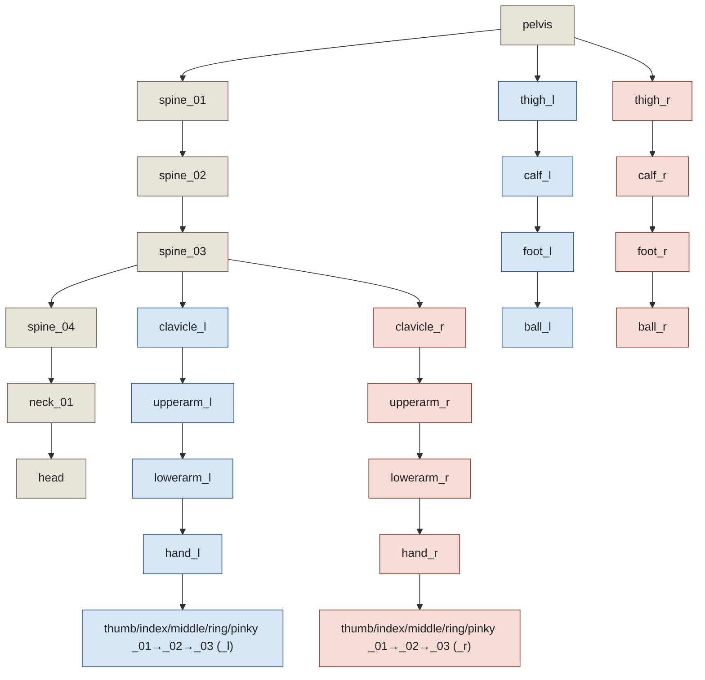
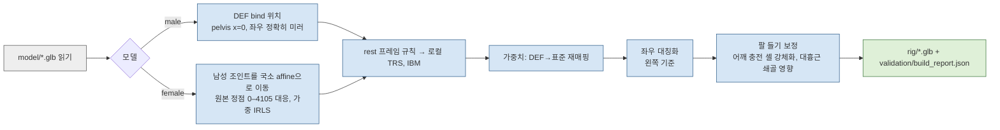

# rig — 표준 휴머노이드 스켈레톤과 skin 연결 GLB

`model/male.glb`, `model/female.glb`(모델러 소관, 수정하지 않음)에서 같은 스켈레톤 규칙을 쓰는 skin 연결 GLB를 만든다. 스켈레톤 id는 **`pose-library-humanoid-v1`**이고 변형 뼈는 53개다. 포즈 파일 형식은 `poses/README.md`에 있다.

| 파일 | 내용 |
|---|---|
| `male.glb`, `female.glb` | skin 연결 결과물. 메시 1개(Body/Joints 재질 프리미티브 2개가 정점 풀 하나를 공유), skin 1개, 관절 53개 |
| `joint_limits.json` | 뼈별·축별 관절 한계(도, rest 기준) |
| `tools/rigcore.py` | 공용 코드: 스켈레톤 정의, rest 프레임 규칙, GLB 입출력, 쿼터니언/오일러, FK, LBS |
| `tools/build_rig.py` | 두 GLB 생성(조인트 피팅, IBM, 가중치 재매핑·대칭화·조정) |
| `tools/check_limits.py` | 포즈의 관절 한계·쿼터니언/오일러 일치·스키마 검사 |
| `tools/check_penetration.py` | 포즈 상태 부위 간 관통/접촉 측정(rest 기준선 포함) |
| `tools/check_deformation.py` | 팔 들기 스트레스 포즈에서 원본 대비 조정 가중치의 늘어남 비교 |
| `tools/check_gltf_pose.py` | GLB 데이터만으로 three.js 방식 포즈 적용을 재현해 rigcore와 비교 |
| `tools/render_pose.py` | headless 미리보기 렌더러(NumPy z-buffer + Pillow) |
| `tools/author_pose_01.py` | 첫 포즈 작성기(참고 이미지 해석 → IK → JSON) |
| `tools/validate_glb.cjs` | Khronos 공식 glTF validator 실행 |
| `previews/`, `validation/` | 렌더와 검사 결과 |

## 1. 뼈 이름 규칙과 결정 이유

**결정: 원본 `DEF-*` 이름을 버리고 UE 마네킹식 표준 이름(`pelvis`, `spine_01`…, `clavicle_l`, `upperarm_l`, `lowerarm_l`, `hand_l`, `index_01_l`…, `thigh_l`, `calf_l`, `foot_l`, `ball_l`)을 쓴다. `DEF-*` 이름은 아래 별칭 표로만 남긴다.**

이유는 다음과 같다.

1. **three.js가 원본 이름을 바꿔 버린다.** `GLTFLoader`는 노드 이름을 `PropertyBinding.sanitizeNodeName`으로 정리하면서 `.`, `:`, `/`, `[`, `]`를 지운다. 그래서 `DEF-upper_arm.L_09`는 뷰어 안에서 `DEF-upper_armL_09`가 된다. 파일 속 이름과 뷰어 속 이름이 달라지면 포즈 키로 쓸 수 없다. 표준 이름은 `[a-z0-9_]`만 쓴다.
2. **원본 이름에는 의미 없는 내보내기 번호가 붙어 있다**(`_09`, `_027`). 같은 뼈인데 좌우 번호도 제각각이다.
3. **토폴로지가 1:1로 맞는다.** 이 메시는 골반 + 척추 4 + 목 1 + 머리, 발가락 뼈 1개(ball) 구조다. UE5 마네킹 이름 체계(`pelvis`, `spine_01..`, `neck_01`, `head`, `ball_*`)가 그대로 대응해, 뼈를 합치거나 지어낼 필요가 없다. VRM 휴머노이드(`spine/chest/upperChest`)는 척추 뼈가 하나 모자라 대응이 깨진다. 원본 자체도 "UE Mannequin Demake"다.
4. **좌우가 명시적이다.** 접미사 `_l` / `_r`는 **캐릭터 자신의** 왼쪽/오른쪽이다(모델 공간 +X가 캐릭터의 왼쪽).

이름만 UE식이고 축 규칙은 UE와 다르다(UE는 +X가 뼈 방향, 여기서는 +Y). UE 리그와 축이 호환된다고 가정하면 안 된다.

원본의 `_rootJoint`, `root_01`(원점, 가중치 0)은 변형에 쓰이지 않아 제외했다. `pelvis`가 skin의 루트다.

| 표준 이름 (L / R) | 부모 | 원본 이름 (`model/male.glb`) | 프레임 규칙 |
|---|---|---|---|
| `pelvis` | — | `DEF-spine_02` | center |
| `spine_01` | `pelvis` | `DEF-spine.001_03` | center |
| `spine_02` | `spine_01` | `DEF-spine.002_04` | center |
| `spine_03` | `spine_02` | `DEF-spine.003_05` | center |
| `spine_04` | `spine_03` | `DEF-spine.004_00` | center |
| `neck_01` | `spine_04` | `DEF-neck_06` | center |
| `head` | `neck_01` | `DEF-head_07` | center |
| `clavicle_l` / `clavicle_r` | `spine_03` | `DEF-shoulder.L_08` / `DEF-shoulder.R_027` | clavicle |
| `upperarm_l` / `upperarm_r` | `clavicle_l` / `clavicle_r` | `DEF-upper_arm.L_09` / `DEF-upper_arm.R_028` | arm |
| `lowerarm_l` / `lowerarm_r` | `upperarm_l` / `upperarm_r` | `DEF-forearm.L_010` / `DEF-forearm.R_029` | arm |
| `hand_l` / `hand_r` | `lowerarm_l` / `lowerarm_r` | `DEF-hand.L_011` / `DEF-hand.R_030` | hand |
| `thumb_01_l` / `thumb_01_r` | `hand_l` / `hand_r` | `DEF-thumb.01.L_024` / `DEF-thumb.01.R_043` | hand |
| `thumb_02_l` / `thumb_02_r` | `thumb_01_l` / `thumb_01_r` | `DEF-thumb.02.L_025` / `DEF-thumb.02.R_044` | hand |
| `thumb_03_l` / `thumb_03_r` | `thumb_02_l` / `thumb_02_r` | `DEF-thumb.03.L_026` / `DEF-thumb.03.R_045` | hand |
| `index_01_l` / `index_01_r` | `hand_l` / `hand_r` | `DEF-f_index.01.L_012` / `DEF-f_index.01.R_031` | hand |
| `index_02_l` / `index_02_r` | `index_01_l` / `index_01_r` | `DEF-f_index.02.L_013` / `DEF-f_index.02.R_032` | hand |
| `index_03_l` / `index_03_r` | `index_02_l` / `index_02_r` | `DEF-f_index.03.L_014` / `DEF-f_index.03.R_033` | hand |
| `middle_01_l` / `middle_01_r` | `hand_l` / `hand_r` | `DEF-f_middle.01.L_015` / `DEF-f_middle.01.R_034` | hand |
| `middle_02_l` / `middle_02_r` | `middle_01_l` / `middle_01_r` | `DEF-f_middle.02.L_016` / `DEF-f_middle.02.R_035` | hand |
| `middle_03_l` / `middle_03_r` | `middle_02_l` / `middle_02_r` | `DEF-f_middle.03.L_017` / `DEF-f_middle.03.R_036` | hand |
| `ring_01_l` / `ring_01_r` | `hand_l` / `hand_r` | `DEF-f_ring.01.L_021` / `DEF-f_ring.01.R_040` | hand |
| `ring_02_l` / `ring_02_r` | `ring_01_l` / `ring_01_r` | `DEF-f_ring.02.L_022` / `DEF-f_ring.02.R_041` | hand |
| `ring_03_l` / `ring_03_r` | `ring_02_l` / `ring_02_r` | `DEF-f_ring.03.L_023` / `DEF-f_ring.03.R_042` | hand |
| `pinky_01_l` / `pinky_01_r` | `hand_l` / `hand_r` | `DEF-f_pinky.01.L_018` / `DEF-f_pinky.01.R_037` | hand |
| `pinky_02_l` / `pinky_02_r` | `pinky_01_l` / `pinky_01_r` | `DEF-f_pinky.02.L_019` / `DEF-f_pinky.02.R_038` | hand |
| `pinky_03_l` / `pinky_03_r` | `pinky_02_l` / `pinky_02_r` | `DEF-f_pinky.03.L_020` / `DEF-f_pinky.03.R_039` | hand |
| `thigh_l` / `thigh_r` | `pelvis` | `DEF-thigh.L_046` / `DEF-thigh.R_050` | leg |
| `calf_l` / `calf_r` | `thigh_l` / `thigh_r` | `DEF-shin.L_047` / `DEF-shin.R_051` | leg |
| `foot_l` / `foot_r` | `calf_l` / `calf_r` | `DEF-foot.L_048` / `DEF-foot.R_052` | leg |
| `ball_l` / `ball_r` | `foot_l` / `foot_r` | `DEF-toe.L_049` / `DEF-toe.R_053` | leg |

## 2. 계층

`pelvis`가 루트다. 척추는 `pelvis → spine_01 → … → spine_04 → neck_01 → head`로 이어진다. 쇄골은 원본처럼 `spine_03`에 붙고, 다리는 `pelvis`에 붙는다. 각 손에는 엄지·검지·중지·약지·소지 3마디씩 15개 뼈가 있다. skin의 `joints` 배열 순서는 `rigcore.BONES` 순서와 같다(아래 노드 인덱스 0–52, 메시 노드는 53).



## 3. 좌표계, rest 프레임, 축의 의미

**모델 공간**: 미터, +Y 위, 캐릭터는 +Z를 바라보고, **+X가 캐릭터의 왼쪽**이다. 바닥은 y = 0, 원점은 두 발 사이다. 두 GLB 모두 메시 노드와 `pelvis`가 씬 루트에 단위 변환으로 있으므로, rest 상태의 accessor 좌표가 곧 모델 공간이다.

**rest 자세**는 원본과 같은 A-pose다.

| rest 각도 | female | male |
|---|---:|---:|
| 위팔과 수직선 사이 | 37.4° | 39.1° |
| 팔꿈치 굽힘 | 29.9° | 29.2° |
| 무릎 굽힘 | 8.1° | 8.4° |
| 손목 굽힘 | 11.6° | 11.7° |
| 발(발목→볼) 아래 기울기 | 41.7° | 41.7° |

**rest 프레임 규칙**(`rigcore.rest_frames`): 모든 뼈의 **+Y는 머리(head)에서 꼬리(tail) 방향**이다. 꼬리는 사슬 자식의 머리이고, `hand`의 꼬리는 `middle_01`의 머리다. 끝 뼈의 방향은 다음과 같다. `head`는 월드 +Y, `ball_*`와 `*_03`는 원본 bind 축을 쓴다. X·Z는 클래스별로 정한다.

| 클래스 | 뼈 | X/Z 결정 | +X 회전의 뜻 |
|---|---|---|---|
| center | pelvis, spine_01–04, neck_01, head | X = 월드 +X를 Y에 수직으로 투영, Z = X×Y(앞) | 앞으로 굽힘(굴곡) |
| leg | thigh, calf, foot, ball | center와 같음 | thigh: 신전(다리가 뒤로), calf: 무릎 굴곡, foot: 저측굴곡, ball: 발가락 굽힘 |
| clavicle | clavicle | X = Y×(월드 +Z) | 전인(어깨가 앞으로) |
| arm | upperarm, lowerarm | X = Y_upperarm × Y_lowerarm (rest 팔꿈치 굽힘 축, 두 뼈 공통) | upperarm: 굴곡(앞으로), lowerarm: 팔꿈치 굴곡 |
| hand | hand, 손가락, 엄지 | Z = 손바닥 법선(손바닥 밖으로), X = Y×Z | 손바닥 쪽으로 굽힘 |

**좌우 미러 규칙**(Blender 방식): 오른쪽 프레임은 왼쪽 프레임을 거울에 비춘 뒤 X를 뒤집은 것이다. 그래서 **같은 해부학적 동작이면 X 각도는 좌우 부호가 같고, Y·Z 각도는 부호가 반대**다. 아래 표는 수치로 검증한 부호다(+10° 회전 시 꼬리 이동 방향). 왼쪽 기준이며 오른쪽은 Y·Z가 반대다.

| 뼈 | +X | +Y (뼈 축 비틀림) | +Z |
|---|---|---|---|
| spine_*, neck_01, head, pelvis | 굴곡(앞으로) | 왼쪽으로 돌림 | 오른쪽으로 옆굽힘 |
| clavicle_l | 전인 | 축 회전 | 거상(어깨 올림) |
| upperarm_l | 굴곡 | 내회전 | 외전(옆으로 들기, 약간 뒤로) |
| lowerarm_l | 팔꿈치 굴곡 | 회내(손바닥이 뒤로) | — (운반각 허용치) |
| hand_l | 손목 굴곡 | — | 요측편위(엄지 쪽) |
| 손가락 *_0n_l | 굴곡(말기) | — | _01: 엄지 쪽으로 벌림 |
| thigh_l | 신전(뒤로) | 내회전 | 내전(안쪽으로) |
| calf_l | 무릎 굴곡 | 경골 회전 | — |
| foot_l | 저측굴곡(발끝 내림) | 외번 | 내전(발끝 안쪽) |
| ball_l | 발가락 굴곡 | — | — |

## 4. 뷰어에서 포즈 적용하기 (three.js)

포즈의 회전은 **각 뼈의 rest 로컬 프레임 기준**이다. 뷰어는 로드 직후 각 뼈의 rest 쿼터니언·위치를 저장해 두고, 포즈마다 rest에 곱한다. 루트 이동은 `pelvis` 위치에만 더하며, 단위가 골반 높이 비율이라 키가 다른 모델에도 그대로 맞는다. 골반 높이는 `pelvis` rest 위치의 y이며 `asset.extras.rig.hipsHeight`에도 기록돼 있다.

```js
// 로드 직후 한 번
const rest = new Map();
skinnedMesh.skeleton.bones.forEach(b => rest.set(b.name, { q: b.quaternion.clone(), p: b.position.clone() }));
const hipsHeight = rest.get('pelvis').p.y;

// 포즈 적용 (pose = poses/*.json)
for (const [name, r] of rest) {
  const bone = skinnedMesh.skeleton.getBoneByName(name);
  bone.quaternion.copy(r.q);                       // 목록에 없는 뼈는 rest
  bone.position.copy(r.p);
  const entry = pose.bones[name];
  if (entry) bone.quaternion.multiply(new THREE.Quaternion(...entry.quaternion));   // rest * pose
}
const t = pose.root.translation;                   // unit: "hipsHeight"
skeleton.getBoneByName('pelvis').position.add(new THREE.Vector3(t[0], t[1], t[2]).multiplyScalar(hipsHeight));
```

```
GLB 로드 → 뼈별 rest 쿼터니언/위치 저장 → bone.quaternion = rest × pose.quaternion → pelvis.position += translation × hipsHeight → 렌더
```

`tools/check_gltf_pose.py`가 이 공식을 GLB 데이터(노드 TRS, 계층, IBM accessor)만으로 재현한다. 결과는 rigcore 스키닝과 female 9.3e-8 m, male 1.1e-7 m 이내로 일치한다.

## 5. skin GLB 생성 (`tools/build_rig.py`)

모델마다 같은 순서로 처리한다. 원본에서 조인트 위치를 정하고, rest 프레임과 IBM을 만들고, 가중치를 옮긴 뒤 GLB를 쓴다. 남성과 여성은 조인트 위치를 구하는 방법만 다르다.



- **남성 조인트**: 원본 bind 행렬 위치를 쓴다. 원본 `DEF-spine` 머리가 x = −0.0178이라 `pelvis`를 x = 0으로 옮겼고(메시는 대칭), 좌우 조인트는 평균을 내 정확한 거울상으로 맞췄다.
- **여성 조인트**: 여성 정점 0–4105는 남성 정점과 같은 번호이고 모프로만 움직였다. 각 뼈마다 그 뼈와 부모 뼈가 지배하는 원본 정점을 조인트로부터의 거리로 가중하고(σ = 손가락 1.5 cm, 손 3 cm, 나머지 6 cm), 흉부 재모델링으로 모프에서 벗어난 정점은 IRLS로 낮춰서, 남성→여성 affine 맵을 맞춘 뒤 조인트에 적용했다. 결과는 모프 의도와 맞는다. 팔은 x×0.869(=0.94×0.925), 고관절은 x×1.138(=1.23×0.925), 머리는 ×0.8695, y는 전 조인트 ×0.925다. 가중 잔차는 팔·다리·손 0–0.2 mm, 머리 1.0 mm이고 척추 3–13 mm다. 척추 잔차는 허리 모프가 x 방향으로 비선형이라 생기며, 중심 조인트는 x = 0이고 y·z가 기대값과 1 mm 안에서 맞으므로 위치에는 영향이 없다(`validation/build_report.json`의 `female_joint_fit`).
- **GLB 구조**: 노드 0–52가 뼈(`translation` + `rotation`만, 스케일 없음)이고 노드 53이 skin 메시다. 정점 풀(male 4,106 / female 5,212)은 원본의 정규 정점 번호를 그대로 유지한다. 속성은 `POSITION`, `NORMAL`(rest), `TEXCOORD_0`, `JOINTS_0`(u8), `WEIGHTS_0`(float, 합 1, 최대 3개 영향)이고, 재질과 원본 저작권 정보(`asset.extras`, CC BY 4.0, RD3D Game Design)는 그대로 보존했다.
- **결정성**: 같은 입력이면 같은 바이트가 나온다(male SHA-256 `12c1cd88…`, female `19fbc043…`, 전체 값은 `build_report.json`).

## 6. 가중치 조정

원본 가중치는 거의 강체다. 정점당 영향은 최대 2개이고, 각 셸이 한 뼈를 따라간다. 조정은 `rig/` 결과물에만 있고 `model/` 원본은 그대로다.

1. **좌우 대칭화(왼쪽 기준)**: 원본은 어깨에서 비대칭이다(L 혼합 가중치 16정점, R 4정점, 최대 차이 0.33). 오른쪽 정점이 거울 짝의 왼쪽 가중치를 받는다. 바뀐 정점은 male 44개, female 468개다(여성의 대부분은 흉부 보간 잡음 ≤ 0.01). 거울 짝이 없는 오른쪽 정점 4개(male (−0.0986, 1.5387, 0.0069), 원본 비대칭)는 그대로 뒀다.
2. **어깨 충전 셸 강체화**: 어깨 안쪽의 어두운 충전 조각(Joints 재질, 44 tri, 한쪽 96정점)은 안쪽 절반이 `clavicle`, 바깥 절반이 `upperarm`에 100%씩 묶여 있었다. 팔을 머리 위로 들면 이 셸의 모서리가 최대 5.4배로 늘어나 겨드랑이에 어두운 쐐기가 생겼다. 셸 전체를 `upperarm_*`에 100% 묶어 팔과 함께 강체로 돌게 했다. 이 셸은 위팔 셸의 열린 윗단도 계속 덮는다.
3. **대흉근/겨드랑이 쪽 쇄골 영향**: 흉부 셸 정점에 어깨 관절로부터의 거리 d에 따라 `clavicle_*` 몫을 준다. d ≤ 6 cm이면 0.30, 16 cm 이상이면 0이고 그 사이는 smoothstep이다(남성 기준 거리, 골반 높이 비율로 스케일). 대상은 female 164정점, male 84정점이다. 쇄골이 올라가면 가슴 위 바깥이 함께 살짝 들린다. 위팔(`upperarm`)이 아니라 쇄골을 쓴 이유는 회전 범위 때문이다. 쇄골은 ±30° 수준이라 섞어도 LBS 붕괴가 없지만, 위팔의 130° 회전을 흉부에 섞으면 그 자체가 늘어남을 만든다.

다음 표는 같은 포즈에서 원본 가중치(대칭화만)와 조정 가중치의 모서리 길이 비율(포즈/rest)을 비교한 것이다(`validation/deformation_check.json`). "어깨 볼 늘어남" 열은 원본 기준 수치이고, 조정 후에는 해당 셸이 더 이상 늘어나지 않는다.

| 포즈 | 모델 | 원본: 어깨 충전 셸 | 조정 후: 변형되는 셸 |
|---|---|---|---|
| 양팔 머리 위(쇄골 25°, 위팔 외전 115°) | female | 0.81–5.43배, 1.2배 초과 32개 | 흉부 0.91–1.17배, 1.2배 초과 0개 |
| 같음 | male | 0.80–5.12배 | 흉부 0.90–1.13배 |
| `pose_01` | female | L 5.37배 / R 0.25배 | 흉부 0.92–1.14배, 복부 0.93–1.08배 |
| `pose_01` | male | L 5.10배 / R 0.24배 | 흉부 0.93–1.10배, 복부 0.93–1.09배 |

비교 렌더는 `previews/arms_overhead_{female,male}_{source,rig}_weights.png`다.

## 7. 관절 가동 범위 (`joint_limits.json`, `tools/check_limits.py`)

- 각 값은 `[min, max]`(도)다. 포즈 쿼터니언(rest 기준)을 three.js Euler `'XYZ'`(R = Rx·Ry·Rz)로 분해한 각 축에 적용한다.
- **rest(A-pose) 기준**이므로 해부학적 중립과 다르다. 예를 들어 팔꿈치는 rest가 이미 약 30° 굽어 있어 x = −30이 완전히 편 상태이고, 무릎은 x = −8이 편 상태다.
- 값은 성인 능동 가동범위(AAOS/Kapandji 수준)를 척추 4개·목·머리에 나눠 배정했다. `pelvis`는 몸 전체 방향이므로 제한하지 않는다.
- 오른쪽 항목은 왼쪽의 미러(x 같음, y·z 부호 반전)다. 검사기가 이 일관성과 53개 뼈 전체 포함 여부도 확인한다.
- 오일러 분해는 Y(비틀림)가 ±90°에 가까우면 짐벌 상태가 되어 X·Z 값이 섞인다. 비틀림 한계는 모두 ±90° 미만이다.

```
pose JSON → (스키마 검사, jsonschema 있을 때) → 뼈별: 단위 쿼터니언? → euler와 쿼터니언 일치(0.05°)? → Euler XYZ 분해 → [min,max] 안? → PASS/FAIL(exit 1)
```

## 8. 검증 결과

| 항목 | 결과 |
|---|---|
| 공식 glTF validator (`validation/*_gltf_validation.json`) | male·female 모두 오류 0, 경고 0, 정보 2(텍스처 없는 프리미티브의 미사용 `TEXCOORD_0`, 원본과 같은 종류) |
| rest 재현 | 포즈 없이 스키닝한 정점이 accessor 위치와 같다(최대 오차 female 8.1e-8 m, male 9.1e-8 m, 뷰어 공식 기준) |
| 뷰어 공식 재현 (`check_gltf_pose.py`) | `pose_01` female 9.3e-8 m, male 1.1e-7 m |
| 관절 한계 (`check_limits.py`) | `pose_01` PASS(48개 뼈). 가장 빠듯한 여유: `hand_r` 0.03°, `lowerarm_l` 0.14°, `hand_l` 0.21°, `upperarm_r` 0.95° |
| 검사기 음성 시험 | 스키마 위반, 알 수 없는 뼈, 오일러/쿼터니언 30° 불일치, 무릎 +10° 초과를 모두 FAIL로 잡음 |
| 결정성 | `build_rig.py`, `author_pose_01.py`를 두 번 실행해 바이트가 같음 |

`pose_01` 관통·접촉 결과(`validation/penetration_pose_01_contrapposto_hand_on_head.json`)다. "안"은 상대 셸 안에 들어간 정점 수, "깊이"는 그 최대 깊이, "교차"는 상대 삼각형을 가로지르는 모서리 수, "간격"은 최소 표면 거리다. 모든 쌍을 양방향으로 쟀다.

| 쌍 | 종류 | female 포즈 | female rest | male 포즈 |
|---|---|---|---|---|
| 왼손 ↔ 머리 | 접촉 | 안 3, 깊이 0.00 mm, 교차 10(표면 접촉) | — | 간격 1.4 mm |
| 오른손 ↔ 골반 | 접촉 | 안 0, 교차 5(표면 접촉) | — | **간격 29 mm(뜸)** |
| 왼팔(위/아래) ↔ 머리 | 회피 | 간격 34 / 16 mm | — | 41 / 17 mm |
| 오른 전완·손 ↔ 몸통/골반 | 회피 | 간격 52 / 29 / 19 mm | — | 78 / 61 / 55 mm |
| 다리 ↔ 다리 | 회피 | 간격 109 mm | 91 mm | 100 mm |
| 왼 위팔 ↔ 몸통 | 회피 | 안 10, 깊이 23 mm | 안 9, 15 mm | 안 10, 23 mm |
| **오른 위팔 ↔ 몸통** | 회피 | **안 20, 깊이 65 mm** | 안 9, 15 mm | 안 20, 69 mm |
| 어깨 충전 셸 L / R ↔ 몸통 | 원래 숨음 | 13 / 62 mm | 53 mm | 13 / 65 mm |

오른 위팔 관통의 원인은 위팔 셸 앞쪽 윗부분(전방 삼각근 캡, rest 위치 (−0.156, 1.397, 0.004))이다. 이 부분은 rest에서 이미 흉부 셸의 위-바깥 앞 모서리에 닿아 있다. 손을 허리에 짚고 팔꿈치를 밖으로 빼는 자세는 상완 내회전이 한계 근처(−69°)까지 필요하고, 그만큼 캡이 흉부 안으로 들어간다. 팔꿈치 swivel(±60°), 쇄골 전인/후인, 손 방향을 바꿔 봐도 52–71 mm 밖으로 줄지 않았다. 흉부 표면 안쪽이라 화면에서는 이음매로만 보인다(`previews/*_three_quarter.png`, `*_side.png`). 근본 해결은 모델 측 어깨 형상 또는 교정 셰이프 키가 필요하다.

## 9. 재현 명령

저장소 루트에서 실행한다. Python 환경은 `/tmp/pose-qa-venv`(NumPy, Pillow)이고, 스키마 검사에는 `jsonschema`가 있는 `python3`를 쓴다.

```sh
PYTHONDONTWRITEBYTECODE=1 /tmp/pose-qa-venv/bin/python rig/tools/build_rig.py
PYTHONDONTWRITEBYTECODE=1 /tmp/pose-qa-venv/bin/python rig/tools/author_pose_01.py
PYTHONDONTWRITEBYTECODE=1 /tmp/pose-qa-venv/bin/python rig/tools/check_limits.py poses/pose_01_contrapposto_hand_on_head.json
PYTHONDONTWRITEBYTECODE=1 python3 rig/tools/check_limits.py poses/pose_01_contrapposto_hand_on_head.json   # + JSON Schema
PYTHONDONTWRITEBYTECODE=1 /tmp/pose-qa-venv/bin/python rig/tools/check_penetration.py poses/pose_01_contrapposto_hand_on_head.json
PYTHONDONTWRITEBYTECODE=1 /tmp/pose-qa-venv/bin/python rig/tools/check_deformation.py poses/pose_01_contrapposto_hand_on_head.json
PYTHONDONTWRITEBYTECODE=1 /tmp/pose-qa-venv/bin/python rig/tools/check_gltf_pose.py poses/pose_01_contrapposto_hand_on_head.json
PYTHONDONTWRITEBYTECODE=1 /tmp/pose-qa-venv/bin/python rig/tools/render_pose.py poses/pose_01_contrapposto_hand_on_head.json --models female male
PYTHONDONTWRITEBYTECODE=1 /tmp/pose-qa-venv/bin/python rig/tools/render_pose.py --models female male --views front side
NODE_PATH=/private/tmp/pose-model-validator/node_modules node rig/tools/validate_glb.cjs
```

```
build_rig → author_pose_01 → check_limits → check_penetration / check_deformation / check_gltf_pose → render_pose → validate_glb
```

`author_pose_01.py`는 `/tmp/pose-ref/pose_reference_01.png`가 있으면 `poses/reference/`로 한 번 복사한다. 이미 복사돼 있으면 그 사본을 쓴다.

## 10. 남은 한계

- **오른 어깨 관통**: 손-허리 자세에서 위팔 캡이 흉부 안 65 mm(male 69 mm)까지 들어간다(위 8절). 강체 셸 마네킹의 구조적 한계다.
- **팔 들기 보정은 쇄골에 의존한다**: 대흉근 보정은 포즈가 `clavicle_*`를 올릴 때만 작동한다. 쇄골 없이 위팔만 들면 흉부는 그대로 있다(늘어나지는 않음).
- **흉부 아래 극의 `spine_02` 몫(약 51%)은 그대로다**(모델러 메모). `pose_01` 정도의 척추 굽힘에서 흉부 셸 모서리 비율은 0.92–1.14배다. 큰 척추 굴곡이나 신전에서는 가슴 아래쪽이 끌릴 수 있다.
- **같은 포즈의 남성 적용**: 회전과 골반 높이 비율 이동만 공유하므로 접촉이 정확하지 않다(오른손 29 mm 뜸, 최저점이 바닥 아래 3.7 mm).
- **관절 한계는 강체 각도 범위다.** 축 사이의 결합(예: 외전 각도에 따라 달라지는 회전 범위)은 표현하지 않는다.
- **법선**: GLB에는 rest 법선이 들어 있다. 포즈 법선은 뷰어의 스키닝(three.js 기본 동작)에 맡긴다.
- **원본 UV 미사용**: validator 정보 2건(원본과 동일).
